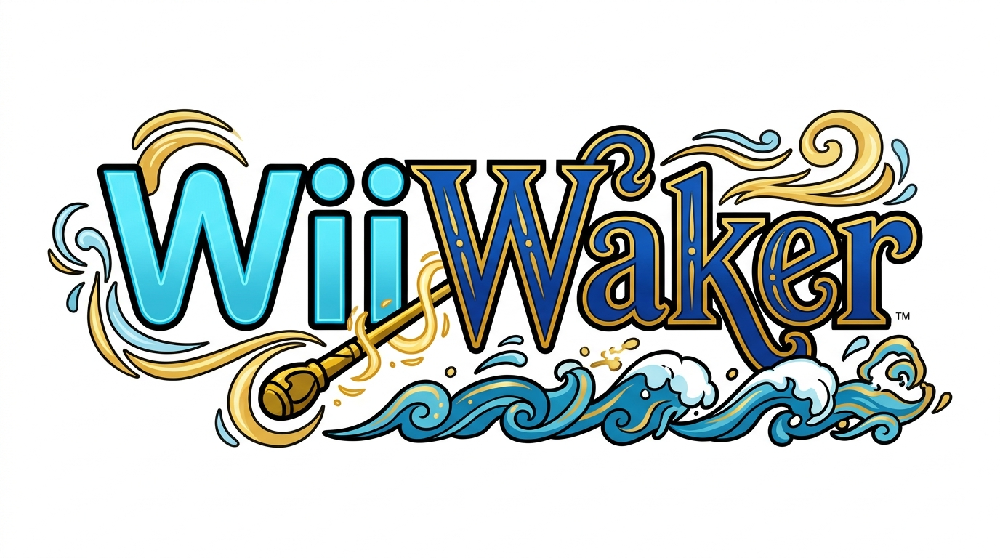
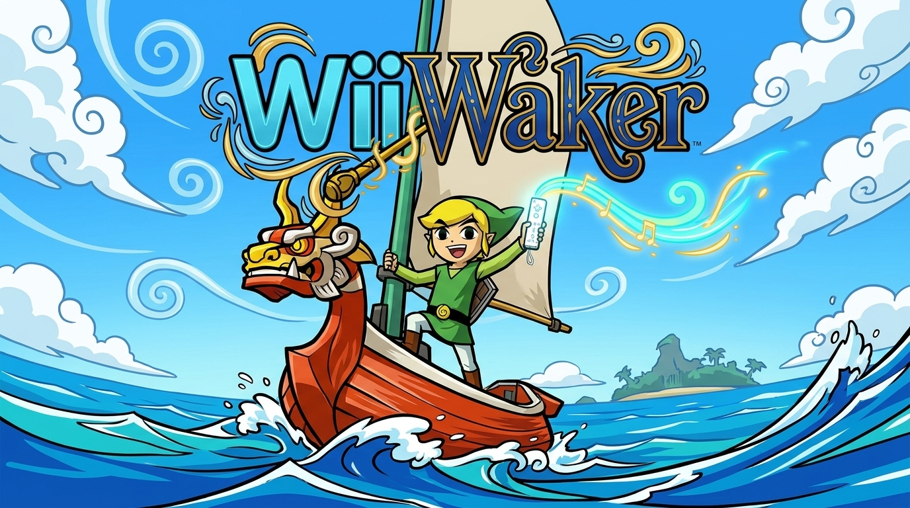
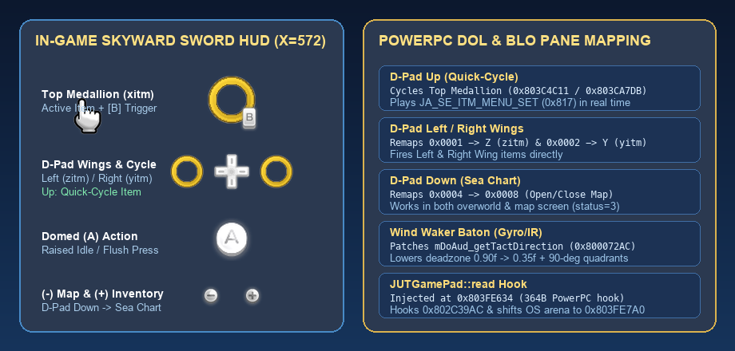
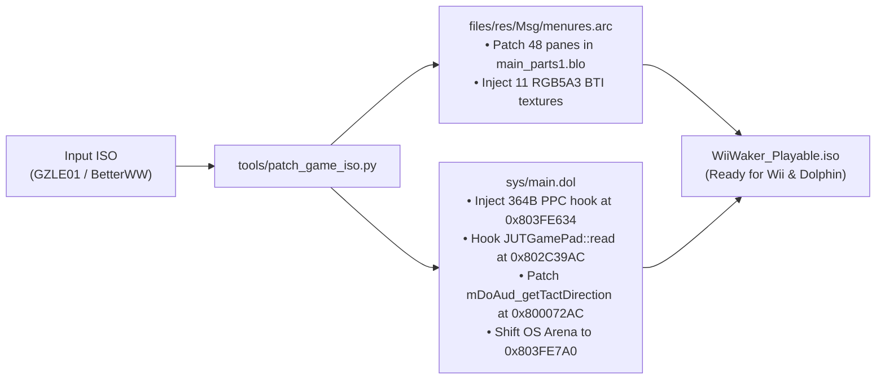

<p align="center">
  
</p>

<h3 align="center">
  Skyward Sword HUD, D-Pad Quick-Equip & Motion/Pointer Baton Overhaul for <em>The Legend of Zelda: The Wind Waker</em>
</h3>

<p align="center">
  
  
  
  
</p>

<p align="center">
  <a href="#-quick-start-play-on-wii-or-dolphin">Quick Start</a> •
  <a href="#-visual-hud-overhaul-gamecube-vs-wiiwaker">Visual HUD Overhaul</a> •
  <a href="#-control-scheme--baton-conducting">Controls & Conducting</a> •
  <a href="#-how-the-binary-patcher-works-under-the-hood">Architecture</a> •
  <a href="#-native-wii-motionplus-telemetry-engine">MotionPlus Engine</a> •
  <a href="#-legal--disclaimer">Legal</a>
</p>

<p align="center">
  
</p>

---

## ✨ What is WiiWaker?

**WiiWaker** transforms *The Legend of Zelda: The Wind Waker* (`GZLE01`) into a native-feeling **Nintendo Wii** experience modeled after *The Legend of Zelda: Skyward Sword*.

It combines two components in one repository:
1. **Playable ISO Binary & Asset Patcher (`tools/patch_game_iso.py`):**
   - Directly patches your Wind Waker GameCube ISO (`BetterWindWaker.iso` or vanilla `GZLE01`) with a **48-pane Skyward Sword vertical HUD layout** (`main_parts1.blo`), **custom cel-shaded Wii button & socket textures** (`menures.arc`), and **364 bytes of custom PowerPC machine code** injected directly into `sys/main.dol` so the in-game controls and Wind Waker baton conducting genuinely match the HUD on a real Wii (via **Nintendont** / **USB Loader GX**) or **Dolphin Emulator**.
2. **Standalone Wii MotionPlus & Hardware Engine (`wii/src/`):**
   - A `devkitPPC` / `libogc` C++ runtime (`WiiWaker.dol`) featuring 6-axis MotionPlus sword slash classification, Nunchuk shield-bash detection, Yamaha ADPCM Wiimote speaker streaming, and a hardware GX 8-way radial item wheel.

---

## 🎨 Visual HUD Overhaul: GameCube vs. WiiWaker

<p align="center">
  
</p>

### Texture & Asset Comparison (`files/res/Msg/menures.arc`)

| HUD Element | Original GameCube (`menures.arc`) | WiiWaker Skyward Sword (`menures.arc`) | BLO Pane & Resolution |
| :--- | :---: | :---: | :--- |
| **Item Medallion Socket** |  |  | `baat` / `ba_base_02.bti` (`48×48` RGB5A3) |
| **Primary Action `(A)`** |  |   | `bawe` / `ba_base_04.bti` (Idle) & `ba_base_03.bti` (Pressed) |
| **Active Item `[B]` Trigger** |  |  | `bab` / `ba_b.bti` (`24×34` clean aspect ratio) |
| **D-Pad & Wing Sockets** |  |  | `ba02` / `cross_key_00.bti` (`X=572, Y=155`) |
| **Map `(-)` & Menu `(+)`** | *GameCube Start / Z* |   | `baz` (`X=543, Y=305`) & `ba0r` (`X=575, Y=305`) |
| **Pointer Cursor** | *Standard Corner Cursor* |  | `cursor_00_01.bti` (`64×64` RGB5A3) |

---

## 🎮 Control Scheme & Baton Conducting

Unlike simple texture packs where the HUD icons don't match the buttons you press, WiiWaker binary-patches `sys/main.dol` so every button on the Skyward Sword HUD works as shown:

| HUD Icon | Controller Input | In-Game Action | Technical Implementation (`sys/main.dol`) |
| :---: | :--- | :--- | :--- |
|  | **D-Pad Up** *(Tap)* | **Quick-Cycle Top Medallion (`xitm`)** | Cycles `save.mSelectItem[0]` (`0x803C4C11`) & `play.mSelectItem[0]` (`0x803CA7DB`) through owned inventory items (`0x803C4C44`) + plays `JA_SE_ITM_MENU_SET` (`0x817`) |
|  | **D-Pad Left** | **Use Left Wing Item (`zitm`)** | Remaps `PAD_BUTTON_LEFT` (`0x0001`) $\rightarrow$ `PAD_TRIGGER_Z` (`0x0010`) in gameplay |
|  | **D-Pad Right** | **Use Right Wing Item (`yitm`)** | Remaps `PAD_BUTTON_RIGHT` (`0x0002`) $\rightarrow$ `PAD_BUTTON_Y` (`0x0800`) in gameplay |
|  | **D-Pad Down** | **Open / Close Sea Chart & Map** | Remaps `PAD_BUTTON_DOWN` (`0x0004`) $\rightarrow$ `PAD_BUTTON_UP` (`0x0008`) in gameplay & on map screen (`dMenu_status == 3`) |
|  | **`[B]` Trigger / `X`** | **Use Top Medallion Item (`xitm`)** | Fires active item equipped in Top Medallion |
|  | **`(A)` Button** | **Context Action / Attack / Roll** | Dynamic context label centered below the `(A)` dome (`X=545, Y=266`) |
|  | **`(+)` / Start** | **Pause & Inventory Menu** | Opens Quest Status, Inventory, and Spoils Bag (D-Pad behaves normally inside menus) |

### 🪄 Wind Waker Baton Conducting (Wiimote Pointer & Tilt/Gyro)

When conducting the **Wind Waker** baton on a Wii via **Nintendont** (or in Dolphin with a Wiimote + Nunchuk):
- **Right Hand (Wiimote IR Pointer or Tilt/Gyro)** controls the **Baton Melody Direction** (Up / Down / Left / Right via C-Stick emulation).
- **Left Hand (Nunchuk Stick)** controls the **Time Signature** (`3/4`, `4/4`, `6/4` via Main Stick).
- **What WiiWaker Patches in `mDoAud_getTactDirection` (`0x80007268`):**
  1. **Lowered Gesture Deadzone (`0.90f` $\rightarrow$ `0.35f` at `0x800072AC`):** Vanilla Wind Waker requires a 90% stick slam before registering a note, forcing Wiimote users to point almost off the TV screen. Lowering the threshold to **35%** makes gentle wrist tilts and pointer movements register immediately.
  2. **Full 90° Directional Quadrants (`0x80007320`):** Removes the narrow $\pm 22.5^\circ$ transition penalty when sweeping between notes without returning to dead-center.
  3. **Tip for Nintendont:** Press **Minus + B** on your Wii Remote at any time to toggle Nintendont's right-hand baton tracking between **IR Pointer Mode** and **Wiimote Tilt/Gyro Mode**.

---

## 🚀 Quick Start: Play on Wii or Dolphin

### 1. Patch Your Wind Waker ISO
Requires Python 3.8+ and `Pillow` (`pip install Pillow`). Pass any legally owned US Wind Waker ISO (`GZLE01`, including `BetterWindWaker.iso`):

```bash
python3 tools/patch_game_iso.py \
  --input "/path/to/BetterWindWaker.iso" \
  --output "/path/to/WiiWaker_Playable.iso"
```

### 2. Copy to Your Wii SD Card (for Nintendont / USB Loader GX)
Format your SD card as **FAT32** and place the patched ISO at the exact path expected by Nintendont:

```text
SD Card Root (/Volumes/CAM_SD)
├── apps/
│   ├── nintendont/
│   │   ├── boot.dol          # Nintendont loader (launches GameCube ISOs on Wii hardware)
│   │   ├── meta.xml
│   │   └── icon.png
│   └── wiiwaker/
│       ├── boot.dol          # Standalone WiiWaker MotionPlus telemetry & GX demo
│       └── meta.xml
└── games/
    └── The Legend of Zelda The Wind Waker [GZLE01]/
        └── game.iso          # Copy WiiWaker_Playable.iso here and rename to game.iso
```

### 3. Launch on Your Wii
1. Insert the SD card into your Wii and open the **Homebrew Channel**.
2. Launch **Nintendont**.
3. Select **SD** $\rightarrow$ **The Legend of Zelda: The Wind Waker [GZLE01]** and press **A** to play!

---

## 🔧 How the Binary Patcher Works Under the Hood



### Verified `sys/main.dol` (`GZLE01`) Memory Map
| Address | Symbol / Structure | Patch / Role |
| :--- | :--- | :--- |
| `0x802C39AC` | `JUTGamePad::read()` | Replaced `bl PADClamp` (`0x80314C90`) with `bl wiiwaker_pad_hook` (`0x803FE634`) |
| `0x803FE634` | `wiiwaker_pad_hook` (Text2) | 364-byte PowerPC routine for D-Pad wings, Top Medallion quick-cycle, and map toggle |
| `0x803FE7A0` | OS Thread Stack Arena | Shifted upward (`0x80307954`, `0x8030794C`, `0x80301854`, `0x80003278`, `0x803370A8`) |
| `0x803ED818` | `JUTGamePad::mPadStatus[0]` | Raw controller button bitmask (`+0x00`) and error status (`+0x0A`) |
| `0x803C4C11` | `save.mSelectItem[0..2]` | Equipped inventory slot indices for `X` (`xitm`), `Y` (`yitm`), and `Z` (`zitm`) |
| `0x803C4C44` | `save.mItems[0..20]` | 21-slot player inventory array (`0xFF` = empty slot) |
| `0x803CA7DB` | `play.mSelectItem[0..2]` | Active HUD item IDs monitored each frame by `dMeter_xyMove` (`0x801F4FEC`) |
| `0x803CA7EE` | `play.mOperateWind` | Wind Waker conducting state flag (`!= 0` disables D-Pad item remapping) |
| `0x803EF095` | `dMenu_status` / `dMenu_pause` | Menu status (`0x803EF095`) and pause flag (`0x803EF097`) |
| `0x802A6720` | `mDoAud_seStart` | Plays `JA_SE_ITM_MENU_SET` (`0x817`) when quick-cycling the Top Medallion |
| `0x800072AC` | `mDoAud_getTactDirection` | Lowers Wind Waker baton deadzone from `0.90f` to `0.35f` + `nop`s narrow cone branch at `0x80007320` |

---

## 🛠️ Native Wii MotionPlus Telemetry Engine (`wii/src/`)

To build the standalone `WiiWaker.dol` homebrew binary from source (requires [devkitPro](https://devkitpro.org) with `wii-dev`):

```bash
./tools/build_wii.sh
```

| Source File | Responsibility |
| :--- | :--- |
| `wii/src/wii_wpad.cpp` | Polls `WPAD_Data`, calibrated `gforce_t` accelerometers, MotionPlus gyro rates, Nunchuk, and IR pointer |
| `wii/src/wii_motion_sword.cpp` | Classifies 8-way directional sword slashes, spin attacks, shield bashes, and baton beat gestures |
| `wii/src/wii_item_wheel.cpp` | Hardware GX orthographic 2D renderer for the 8-slot radial item wheel overlay |
| `wii/src/wii_audio_speaker.cpp` | 3000 Hz 4-bit Yamaha ADPCM encoder and streamer for the Wii Remote speaker |
| `wii/src/wii_gx_render.cpp` | Native 16:9 widescreen projection & GX display list helpers |
| `wii/src/wii_storage.cpp` | `libfat` SD card mounting and `/save/wiiwaker_save.dat` persistence |

---

## ⚖️ Legal & Disclaimer

**The Legend of Zelda: The Wind Waker** and **The Legend of Zelda: Skyward Sword** are registered trademarks of **Nintendo Co., Ltd.**

- This repository contains **zero copyrighted Nintendo game binaries, zero `.iso` disc images, and zero proprietary `.arc` archives**.
- You must legally own an official retail copy of *The Legend of Zelda: The Wind Waker* (`GZLE01`) to use `tools/patch_game_iso.py`.
- Licensed under the [MIT License](LICENSE).
